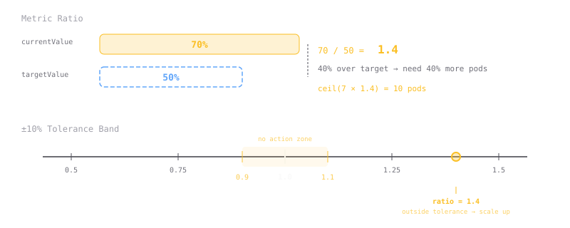
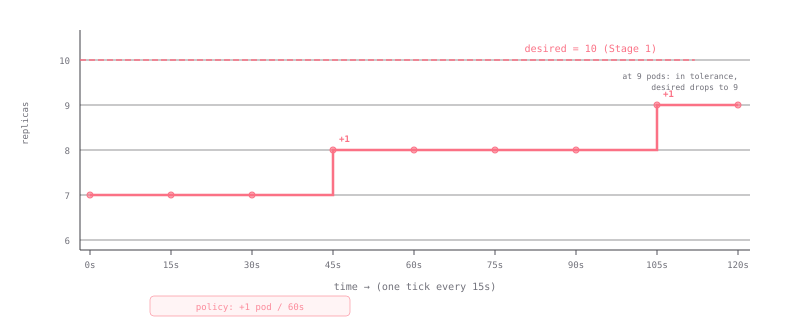
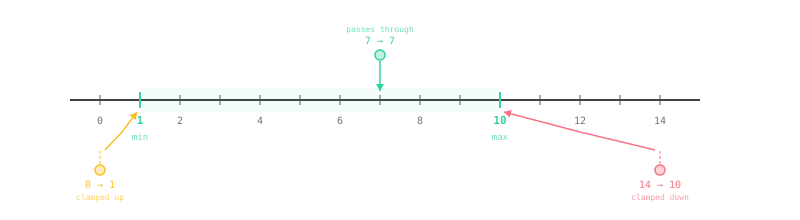
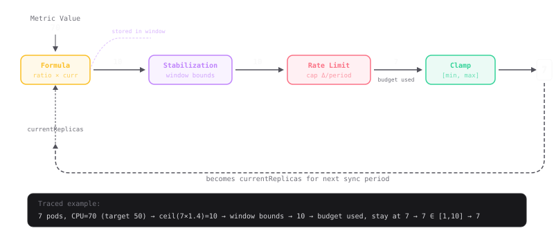

The Horizontal Pod Autoscaler (HPA) automatically adjusts the number of pod replicas in a deployment based on observed metrics. Every **sync period** (default: 15 seconds), it runs a four-stage pipeline to decide whether to scale up, scale down, or do nothing.


This article walks through each stage, building the full picture incrementally.

---

## Stage 1: The Formula — Metric Ratio × Current Pods

The HPA watches a metric you define — CPU utilization, request rate, custom metrics — and you tell it a **target** value. This target is your 100% baseline.

**Example:** You want each pod to run at about half of the CPU it requested, so you set the target to 50% utilization.

Every sync period, the HPA reads the current metric value, computes the **ratio** (`currentValue / targetValue`), and multiplies current replicas by that ratio:

```
desiredReplicas = ceil(currentReplicas × currentValue / targetValue)
```

**Concrete example:** You have 7 pods, the target is 50%, and average CPU utilization is at 70%.

```
ratio = 70 / 50 = 1.4  (40% over target)
desired = ceil(7 × 1.4) = ceil(9.8) = 10 pods
```

The metric is 40% over target, so we need 40% more pods. This works for scale-down too: if utilization drops to 35%, ratio = 0.7, desired = ceil(7 × 0.7) = ceil(4.9) = 5 pods.

We'll follow these seven pods through all four stages.



### The ±10% Tolerance Band

The HPA doesn't react to tiny fluctuations. If the ratio is within **±10% of 1.0** (i.e., between 0.9 and 1.1), it does nothing. That 10% is the cluster-wide default; since Kubernetes 1.35 you can also set a `tolerance` per HPA and per direction. This prevents constant micro-adjustments when the metric hovers near the target.

### Multiple Metrics

If you configure multiple metrics (e.g., CPU and memory), the HPA computes desired replicas for each metric independently and takes the **maximum**. This ensures you have enough pods to satisfy the most demanding metric.

If one of the metrics can't be read, the HPA still scales up on the ones that work, but it refuses to scale down: the missing metric might have asked for more.

### The Feedback Loop

The formula uses *current replicas* as input, which creates a feedback loop. If the HPA scaled to 8 last sync, the formula uses 8 as its starting point next sync. This means desired replicas can overshoot — if the metric is still high but declining, the formula may compute an even higher number because it's multiplying against more replicas. The HPA dampens this itself: the multiplication counts only pods that are ready, and pods that are not ready yet count as using 0% of the target when it considers scaling up.

---

## Stage 2: Stabilization — "Don't Panic"

### The Problem

The raw formula output can be noisy. One sync period says 20 pods, the next says 5, the next says 18. If the HPA acted on every fluctuation immediately, replicas would bounce up and down constantly — **flapping**.

### The Solution: Look Back Before Acting

Stabilization keeps a **sliding window** of recent raw desired values (the Stage 1 outputs — the unfiltered proposals, not the results of previous stages). Before acting, it looks at the last N seconds of recommendations and picks a conservative value.

Why does it look at raw values and not filtered ones? Because if it only saw the already-smoothed output, it would have nothing to smooth. It needs to see the actual noise to filter it out.

There are **two separate windows**, one for each direction, and each one turns into a bound:

- **Scale-down window** (default: 300 seconds / 5 minutes): the HPA may shrink only down to the **maximum** of the raw values in it. "Someone recently said we need this many pods. Don't rush to remove them."
- **Scale-up window** (default: 0 seconds — disabled): the HPA may grow only up to the **minimum** of the raw values in it. "Only add what every recent recommendation agrees on."

The HPA starts from the current replica count. Below the scale-up minimum, it is raised to it; above the scale-down maximum, it is lowered to it; in between, nothing changes. The current proposal counts as part of both windows and is stored in the history afterwards.


The diagram jumps ahead in our example: the seven pods have grown to nine, and then the load has dropped. The shaded region is the 180-second scale-down window. Dots are the raw desired values from Stage 1 at each sync. The 10s from the scale-up have already expired, but four 9s are still inside. The solid line is their **maximum** — so the HPA stays at 9 pods although the newest proposals say 5 or 6. It won't drop until those 9s leave the window.

### What Stabilization Does NOT Do

- It does **not** change the formula output. Stage 1 still computes the same raw desired each tick.
- The stabilized value does **not** feed back into the next tick's formula. The formula always uses the *actual* replica count (after all four stages).
- It only filters the *recommendation*. The actual scaling decision still goes through rate limiting and clamping.

---

## Stage 3: Rate Limiting — "Speed Limit on Scaling"

### The Problem

Even with stabilization smoothing out the recommendation, the HPA might want to make large jumps. If you're at 3 pods and stabilization says you need 20, jumping straight to 20 could overwhelm your infrastructure — thundering herd, resource contention, cascading failures.

### The Solution: Cap How Fast Replicas Can Change

Rate limiting defines **policies** — rules that limit how many replicas can be added or removed within a time window. Think of it as a speed limit: even if the destination is far away, you can only drive so fast.

Each policy has three parts:
- **Type**: `Pods` (absolute number) or `Percent` (proportion of current count)
- **Value**: how much change is allowed
- **Period**: the time window to measure against (in seconds)

**Example with Pods:** "Max +4 pods per 60 seconds" — if you already added 2 pods in the last 60 seconds, you can only add 2 more this tick.

**Example with Percent:** "Max +50% per 60 seconds" — if you started the period at 10 pods, you can scale up to at most 15 (10 × 1.5).



The staircase shows how rate limiting works in practice. The desired value sits at 10 (dashed line), but the actual replicas climb one step at a time. Each sync period, the rate limiter checks the budget — if the policy allows +1 pod per 60s, you get one pod, then nothing for the next three ticks.

### Period Start Replicas

The key concept in rate limiting is **period start replicas** — "where were we at the start of this policy's time window?" The HPA computes this by rewinding through recent scale events:

```
periodStartReplicas = currentReplicas - replicasAddedInPeriod + replicasDeletedInPeriod
```

If you already used some of your "budget" for the period, the remaining budget is smaller.

### Multiple Policies and selectPolicy

You can define multiple policies per direction. The `selectPolicy` field controls how they combine:

- **Max** (default): pick the most permissive policy — allows the most change
- **Min**: pick the most restrictive policy — allows the least change
- **Disabled**: turn off scaling in this direction entirely

Rate limiting doesn't have its own timer. It's evaluated at every sync period. The `periodSeconds` on a policy is just a lookback window.

---

## Stage 4: Clamping — The Safety Net

After the formula, stabilization, and rate limiting have all had their say, clamping enforces the hard boundaries:

```
actual = max(minReplicas, min(maxReplicas, rateLimitedValue))
```

If the pipeline computed 12 pods but `maxReplicas` is 10, the actual becomes 10. If it computed 0 but `minReplicas` is 1, the actual becomes 1.



### Clamping Is Applied Last

This ordering matters. The entire pipeline runs fully — the formula might say 14, stabilization confirms 14, rate limiting allows 14 — and only at the very end does clamping say "nope, max is 10."

The consequence: **the stabilization window still remembers that 14.** Since stabilization looks at raw Stage 1 outputs (not clamped values), future scale-down decisions will be held by that high recommendation until it expires from the window. Clamping doesn't erase the signal — it just prevents the actual scaling from exceeding bounds.

One exception to the ordering: if the *current* replica count is already outside the bounds (say you lowered `maxReplicas`), the HPA skips the pipeline and goes straight to the bound.

---

## The Full Pipeline

Every sync period (default 15 seconds), the HPA runs all four stages in sequence. The only feedback loop: the final actual replica count becomes `currentReplicas` for the next sync.



### Tracing a Single Sync Period

Back to our 7 pods at 70% CPU with a target of 50%. The scale-down stabilization window is 180s, the rate limit is +1 pod per 60s, and the bounds are min=1, max=10. One tick ago, the HPA already scaled from 6 to 7.

1. **Stage 1:** `ceil(7 × 70/50) = ceil(9.8) = 10` → raw desired = 10
2. **Stage 2:** Recent raw desires over the last 180s: [8, 7, 6, 10]. The scale-up window is 0, so the lower bound is just the current proposal: 10. The scale-down window gives an upper bound of max = 10. Current replicas (7) are below the lower bound, so they are raised to it. → stabilized = 10
3. **Stage 3:** Policy: +1 pod per 60s. Period start replicas = 6 (rewound from 7, found a +1 event). Limit = 6 + 1 = 7. Desired is 10 > current 7, so up-limit applies: min(10, 7) = 7. → rate limited = 7 (no change, budget exhausted)
4. **Stage 4:** min=1, max=10. 7 is within bounds. → actual = 7

### The Next Two Minutes

One tick where nothing happens is only half the story. Assume the total load stays the same and new pods are ready within a tick:

| Time | Pods | CPU | Stage 1 | Stage 2 | Stage 3 | Result |
|------|------|-----|---------|---------|---------|--------|
| 0s | 7 | 70% | 10 | 10 | 7 — the +1 from 15s ago is still inside the 60s window | 7 |
| 15s, 30s | 7 | 70% | 10 | 10 | 7 | 7 |
| 45s | 7 | 70% | 10 | 10 | 8 — that +1 is now 60s old and drops out | **8** |
| 60s – 90s | 8 | 61% | 10 | 10 | 8 | 8 |
| 105s | 8 | 61% | 10 | 10 | 9 | **9** |
| 120s | 9 | 54% | 9 | 9 | 9 | 9 |

Three things to notice:

- **The staircase is the rate limit.** The formula asks for 10 from the first tick on, but the pods arrive one per minute.
- **More pods lower the metric.** The same load spread over 8 pods is 61% each, over 9 pods 54%. Stage 1 still says `ceil(8 × 61.25/50) = 10` at 8 pods, because the total hasn't changed.
- **The HPA stops at 9, not 10.** At 9 pods the ratio is 54.4 / 50 = 1.09 — inside the tolerance band. The formula returns the current count and the scaling is over, one pod short of what it asked for two minutes earlier.

The scale-down window has its say afterwards. Those raw 10s stay in it for 180 seconds, so even if the load dropped right now, the HPA would not remove a pod until they have expired.

Real ticks are not this tidy: whether the old event has left the window at 45s or only at 60s is a matter of milliseconds.

---

## Configuring the Behavior API

All stabilization and rate limiting is configured through the HPA's `behavior` field. This is the configuration from the trace:

```yaml
apiVersion: autoscaling/v2
kind: HorizontalPodAutoscaler
metadata:
  name: my-app
spec:
  scaleTargetRef:
    apiVersion: apps/v1
    kind: Deployment
    name: my-app
  minReplicas: 1
  maxReplicas: 10
  metrics:
    - type: Resource
      resource:
        name: cpu
        target:
          type: Utilization
          averageUtilization: 50             # Target: 50% of the CPU request
  behavior:
    scaleUp:
      stabilizationWindowSeconds: 0          # No delay on scale-up (default)
      policies:
        - type: Pods
          value: 1
          periodSeconds: 60                  # Max +1 pod per 60s
      selectPolicy: Max                      # Only one policy, so nothing to choose
    scaleDown:
      stabilizationWindowSeconds: 180        # Hold scale-down for 3 minutes
      policies:
        - type: Percent
          value: 100
          periodSeconds: 15                  # No rate limit on the way down (default)
      selectPolicy: Max
```

### Key Defaults

| Setting | Scale-Up Default | Scale-Down Default |
|---------|------------------|--------------------|
| Stabilization Window | 0s (immediate) | 300s (5 minutes) |
| Policies | +4 pods/15s, +100%/15s | -100%/15s |
| Select Policy | Max | Max |

These defaults fill in whatever you leave out of `behavior`. If you leave out the whole block, the controller takes an older, simpler path with the same effect: the recommendation is the highest raw value of the last five minutes, and a single sync adds at most as many pods as are already running (or enough to reach 4). It keeps no history of scale events there, so there is nothing to rewind.

The asymmetric defaults reflect Kubernetes' philosophy: **scale up quickly** (don't lose traffic) but **scale down cautiously** (don't kill pods you might need in a minute).

---

## Summary

| Stage | Input | Output | Purpose |
|-------|-------|--------|---------|
| **1. Formula** | Metric value, current replicas | Raw desired replicas | "How many pods does the math say we need?" |
| **2. Stabilization** | Raw desired + history window | Stabilized desired | "Is it safe to act on this, or is it noise?" |
| **3. Rate Limiting** | Stabilized desired + event history | Constrained desired | "How fast are we allowed to get there?" |
| **4. Clamping** | Constrained desired | Actual replicas | "Are we within [min, max] bounds?" |
