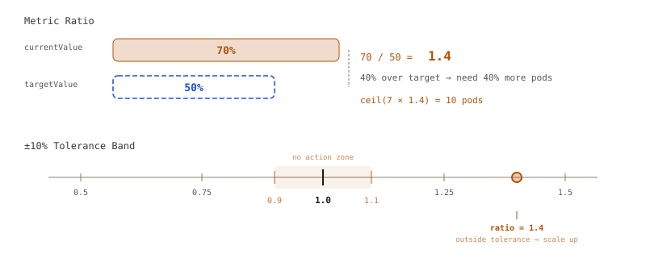
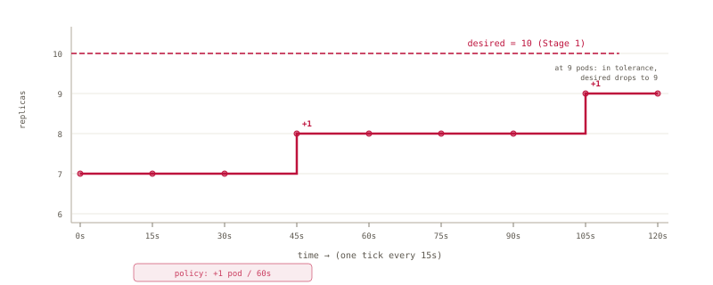
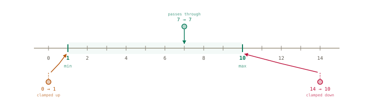
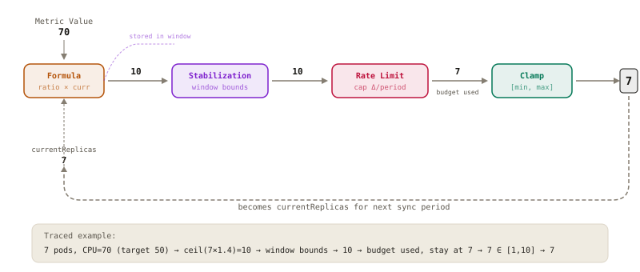
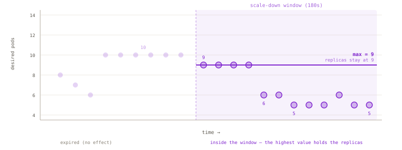

Most people picture the Horizontal Pod Autoscaler (HPA) as one rule: if CPU goes above the target, add pods. That rule exists, but it is only the first of four stages the HPA runs every **sync period** (default: 15 seconds; we'll call one run a **tick**). The other three are why it so often scales later, slower or less than you expected.


This article walks through each stage, building the full picture incrementally.

---

## Stage 1: The Formula

The HPA watches a metric you define, such as CPU utilization, request rate or a custom metric, and you tell it a **target** value. This target is your 100% baseline.

**Example:** You want each pod to run at about half of the CPU it requested, so you set the target to 50% utilization.

Every sync period, the HPA reads the current metric value, computes the **ratio** (`currentValue / targetValue`), and multiplies current replicas by that ratio:

```
desiredReplicas = ceil(currentReplicas × currentValue / targetValue)
```

**Concrete example:** You have 7 pods, the target is 50%, and average CPU utilization is at 70%.

```
ratio = 70 / 50 = 1.4  (40% over target)
desired = ceil(7 × 1.4) = ceil(9.8) = 10 pods
```

The metric is 40% over target, so the formula asks for 40% more pods: 9.8, rounded up to 10. This works for scale-down too: if utilization drops to 35%, ratio = 0.7, desired = ceil(7 × 0.7) = ceil(4.9) = 5 pods.

We'll follow these seven pods through all four stages. The HPA in this example is configured with:

- **target:** 50% CPU utilization
- **bounds:** at least 1, at most 10 replicas
- **scale-up limit:** +1 pod per 60 seconds
- **scale-down stabilization window:** 180 seconds (the default is 300)

The YAML for exactly this setup is in [Configuring the Behavior API](#configuring-the-behavior-api).



### The ±10% Tolerance Band

The HPA doesn't react to tiny fluctuations. If the ratio is within **±10% of 1.0** (i.e., between 0.9 and 1.1), Stage 1 returns the current replica count unchanged, so nothing scales. At 9 pods and a ratio of 1.09, for example, the formula would give `ceil(9 × 1.09) = 10`, but the result is 9. That 10% is the cluster-wide default; since Kubernetes 1.35 you can also set a `tolerance` per HPA and per direction. This prevents constant micro-adjustments when the metric hovers near the target.

### Multiple Metrics

If you configure multiple metrics (e.g., CPU and memory), the HPA computes desired replicas for each metric independently and takes the **maximum**. This ensures you have enough pods to satisfy the most demanding metric.

If one of the metrics can't be read, the HPA still scales up on the ones that work, but it refuses to scale down: the missing metric might have asked for more.

### The Feedback Loop

The formula uses *current replicas* as input, which creates a feedback loop. If the HPA scaled to 8 last tick, the formula starts from 8 next tick. That loop is what makes scaling settle: more pods spread the same load thinner, the ratio falls, and the formula stops asking for more. You'll see it happen in the trace below.

It can also overshoot. A new pod needs time to start, and until it reports metrics, the old pods still look busy, so the formula keeps asking for more. The HPA dampens this while it averages the metric, and it treats two kinds of pods differently:

- **Pods that aren't ready yet** (for CPU): they are set aside. If the remaining pods call for a scale-up, the starting pods count as using 0% of the target, which pulls the average down.
- **Pods without metrics:** they count as 0% when the HPA is scaling up and as exactly 100% of the target when it is scaling down. Either way, it moves less.

If the recalculated ratio then points the other way or lands inside the tolerance band, nothing scales. This damping is what keeps slow-starting containers, a JVM warming up or a model loading into memory, from setting off a runaway scale-up.

---

## Stage 2: Stabilization

### The Problem

The raw formula output can be noisy. One sync period says 20 pods, the next says 5, the next says 18. If the HPA acted on every fluctuation immediately, replicas would bounce up and down constantly. This is called **flapping**.

### The Solution: Look Back Before Acting

Stabilization keeps a **sliding window** of recent raw desired values (the unfiltered Stage 1 outputs, not the results of later stages). Before acting, it looks at the last N seconds of recommendations and picks a conservative value.

Why does it look at raw values and not filtered ones? Because if it only saw the already-smoothed output, it would have nothing to smooth. It needs to see the actual noise to filter it out.

There are **two separate windows**, one for each direction. Each one decides how far the HPA may move from the current replica count:

- **Scaling up** (window default: 0 seconds, so only the current proposal): if the current count is below the window's **minimum**, it goes up to that minimum and no further. "Only add what every recent recommendation agrees on."
- **Scaling down** (window default: 300 seconds): if the current count is above the window's **maximum**, it comes down to that maximum and no further. "Someone recently said we need this many pods. Don't rush to remove them."
- **Otherwise**, the count stays where it is.

The current proposal counts as part of both windows and is stored in the history afterwards. Taken together, the two windows form a corridor around the current count:

```
upLimit    = min(recommendations in the scale-up window)
downLimit  = max(recommendations in the scale-down window)
stabilized = currentReplicas, raised to upLimit if below it,
             lowered to downLimit if above it
```

Why the *minimum* for scaling up? Say you set a 60-second scale-up window and a single 15-second spike asks for 20 pods. The older, lower recommendations in the window keep the minimum down, so the HPA only scales up once the high load has lasted the whole window. The scale-down window works the same way in the other direction; you'll see it hold our pods [after the trace](#and-on-the-way-down).

### What Stabilization Does NOT Do

- It does **not** change the formula output. Stage 1 still computes the same raw desired each tick.
- The stabilized value does **not** feed back into the next tick's formula. The formula always uses the *actual* replica count (after all four stages).
- It only filters the *recommendation*. The actual scaling decision still goes through rate limiting and clamping.

---

## Stage 3: Rate Limiting

### The Problem

Even with stabilization smoothing out the recommendation, the HPA might want to make large jumps. If you're at 3 pods and stabilization says you need 20, jumping straight to 20 could overwhelm your infrastructure with a thundering herd, resource contention and cascading failures.

### The Solution: Cap How Fast Replicas Can Change

Rate limiting defines **policies**: rules that limit how many replicas can be added or removed within a time window. Think of it as a speed limit: even if the destination is far away, you can only drive so fast.

Each policy has three parts:
- **Type**: `Pods` (absolute number) or `Percent` (proportion of current count)
- **Value**: how much change is allowed
- **Period**: the time window to measure against (in seconds)

**Example with Pods** (outside our running example): "Max +4 pods per 60 seconds." If you already added 2 pods in the last 60 seconds, you can only add 2 more this tick.

**Example with Percent:** "Max +50% per 60 seconds." If you started the period at 10 pods, you can scale up to at most 15 (10 × 1.5). The HPA rounds up here, so even a single pod can grow: `ceil(1 × 1.5) = 2`.



The staircase is the first two minutes of our example. Stage 1 asks for 10 pods (dashed line), but with +1 pod per 60 seconds the replicas climb one step at a time: 7, 8, 9. The dots are ticks. At each one the rate limiter checks the budget, and most of the time it is used up, so the count doesn't move.

### Period Start Replicas

The key concept in rate limiting is **period start replicas**: where were we at the start of this policy's time window? The HPA computes this by rewinding through recent scale events:

```
periodStartReplicas = currentReplicas
                    - replicasAddedInPeriod
                    + replicasDeletedInPeriod
```

In our example at tick 0s: 7 current − 1 added at −15s + 0 removed = 6 at the start of the 60-second period. With +1 pod per 60 seconds, the most the HPA may run right now is 6 + 1 = 7. The budget is already used up.

### Multiple Policies and selectPolicy

You can define multiple policies per direction. The `selectPolicy` field controls how they combine:

- **Max** (default): pick the most permissive policy, the one that allows the most change
- **Min**: pick the most restrictive policy, the one that allows the least change
- **Disabled**: turn off scaling in this direction entirely

Rate limiting doesn't have its own timer. It's evaluated at every sync period. The `periodSeconds` on a policy is just a lookback window.

---

## Stage 4: Clamping

After the formula, stabilization, and rate limiting have all had their say, clamping enforces the hard boundaries:

```
actual = max(minReplicas, min(maxReplicas, rateLimitedValue))
```

If the pipeline computed 14 pods but `maxReplicas` is 10, the actual becomes 10. If it computed 0 but `minReplicas` is 1, the actual becomes 1.



### Clamping Is Applied Last

This ordering matters. Say our seven pods hit 100% CPU, and the scale-up limit were the default +100% per 15 seconds instead of +1 pod per minute. The formula says `ceil(7 × 100/50) = 14`, stabilization confirms 14, rate limiting allows 14 (double of 7). Only at the very end does clamping say "nope, max is 10."

The consequence: **the stabilization window still remembers that 14.** Since stabilization looks at raw Stage 1 outputs (not clamped values), future scale-down decisions will be held by that high recommendation until it expires from the window. Clamping doesn't erase the signal. It only prevents the actual scaling from exceeding bounds.

One exception to the ordering: if the *current* replica count is already outside the bounds (say you lowered `maxReplicas`), the HPA skips the pipeline and goes straight to the bound.

---

## The Full Pipeline

Every sync period (default 15 seconds), the HPA runs all four stages in sequence. The only feedback loop: the final actual replica count becomes `currentReplicas` for the next sync.



### Tracing a Single Sync Period

Back to our 7 pods at 70% CPU with a target of 50%, using the settings from Stage 1. Call this tick 0s. One tick earlier, at −15s, the HPA already scaled from 6 to 7.

1. **Stage 1:** `ceil(7 × 70/50) = ceil(9.8) = 10` → raw desired = 10
2. **Stage 2:** The scale-up window is 0 seconds, so it holds only the current proposal: its minimum is 10. Current replicas (7) are below that, so they go up to 10. The scale-down window also holds older, lower proposals, but it only matters when scaling down. → stabilized = 10
3. **Stage 3:** Policy: +1 pod per 60s. Period start replicas = 6 (rewound from 7: the +1 at −15s is inside the last 60 seconds). Limit = 6 + 1 = 7. Desired is 10 > current 7, so up-limit applies: min(10, 7) = 7. → rate limited = 7 (no change, budget exhausted)
4. **Stage 4:** min=1, max=10. 7 is within bounds. → actual = 7

### The Next Two Minutes

One tick where nothing happens is only half the story. Assume the total load stays the same (7 pods × 70% = 490% of one pod's CPU request) and that new pods are ready within a tick. The Stage 2 column shows `upLimit` and `downLimit` next to the result:

| Time | Pods | CPU | Stage 1 | Stage 2 (upLimit / downLimit → result) | Stage 3 | Result |
|------|------|-----|---------|------------------------------|---------|--------|
| 0s | 7 | 70% | 10 | 10 / 10 → 10 | 7: the +1 from −15s is still inside the 60s window | 7 |
| 15s, 30s | 7 | 70% | 10 | 10 / 10 → 10 | 7 | 7 |
| 45s | 7 | 70% | 10 | 10 / 10 → 10 | 8: the +1 from −15s is now 60s old and drops out | **8** |
| 60s – 90s | 8 | 61% | 10 | 10 / 10 → 10 | 8 | 8 |
| 105s | 8 | 61% | 10 | 10 / 10 → 10 | 9 | **9** |
| 120s | 9 | 54% | 9 (in tolerance) | 9 / 10 → 9 | 9 | 9 |

Three things to notice:

- **The staircase is the rate limit.** The formula asks for 10 from the first tick on, but the pods arrive one per minute.
- **More pods lower the metric.** 490% spread over 8 pods is 61% each, over 9 pods 54%. Stage 1 still says `ceil(8 × 61.25/50) = 10` at 8 pods, because the total hasn't changed.
- **The HPA stops at 9, not 10.** At 9 pods the ratio is 54.4 / 50 = 1.09, inside the tolerance band. The formula returns the current count and the scaling is over, one pod short of what it asked for two minutes earlier.

The scale-down window has its say afterwards. At 120s its maximum is still 10, as the Stage 2 column shows. Those raw 10s stay in the window for 180 seconds, so even if the load dropped right now, the HPA would not remove a pod until they have expired.

Real ticks are not this tidy: whether the +1 from −15s has left the 60-second window at 45s or only at 60s depends on milliseconds.

### And on the Way Down

A minute after the trace ends, the load drops. The diagram picks up there: each dot is one tick's raw recommendation from Stage 1, and the shaded region is our 180-second scale-down window.



The 10s from the scale-up have left the window, but four 9s are still inside. The solid line is the window's **maximum**, 9, so the HPA stays at 9 pods although the newest proposals say 5 or 6. It won't come down until those 9s leave the window.

---

## Configuring the Behavior API

All stabilization and rate limiting is configured through the HPA's `behavior` field. This is the configuration from the trace:

```yaml
apiVersion: autoscaling/v2
kind: HorizontalPodAutoscaler
metadata:
  name: my-app
spec:
  scaleTargetRef:
    apiVersion: apps/v1
    kind: Deployment
    name: my-app
  minReplicas: 1
  maxReplicas: 10
  metrics:
    - type: Resource
      resource:
        name: cpu
        target:
          type: Utilization
          # Target: 50% of the CPU request
          averageUtilization: 50
  behavior:
    scaleUp:
      # No delay on scale-up (default)
      stabilizationWindowSeconds: 0
      # At most +1 pod per 60s
      policies:
        - type: Pods
          value: 1
          periodSeconds: 60
      # Only one policy, so nothing to choose
      selectPolicy: Max
    scaleDown:
      # Hold scale-down for 3 minutes
      stabilizationWindowSeconds: 180
      # No rate limit on the way down (default)
      policies:
        - type: Percent
          value: 100
          periodSeconds: 15
      selectPolicy: Max
```

### Key Defaults

| Setting | Scale-Up Default | Scale-Down Default |
|---------|------------------|--------------------|
| Stabilization Window | 0s (immediate) | 300s (5 minutes) |
| Policies | +4 pods/15s, +100%/15s | -100%/15s |
| Select Policy | Max | Max |

These defaults fill in whatever you leave out of `behavior`. If you leave out the whole block, the controller takes an older, simpler path with the same effect: the recommendation is the highest raw value of the last five minutes, and a single sync adds at most as many pods as are already running (or enough to reach 4). It keeps no history of scale events there, so there is nothing to rewind.

The asymmetric defaults reflect Kubernetes' philosophy: **scale up quickly** (don't lose traffic) but **scale down cautiously** (don't kill pods you might need in a minute).

---

## Summary

| Stage | Input | Output | Purpose |
|-------|-------|--------|---------|
| **1. Formula** | Metric value, current replicas | Raw desired replicas | "How many pods does the math say we need?" |
| **2. Stabilization** | Raw desired + history window | Stabilized desired | "Is it safe to act on this, or is it noise?" |
| **3. Rate Limiting** | Stabilized desired + event history | Constrained desired | "How fast are we allowed to get there?" |
| **4. Clamping** | Constrained desired | Actual replicas | "Are we within [min, max] bounds?" |
